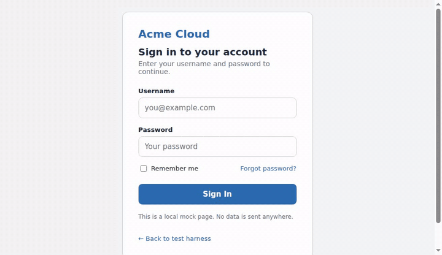
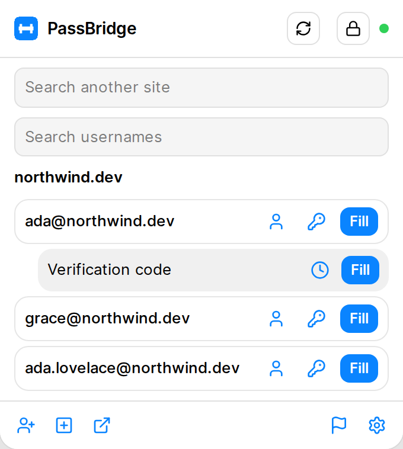
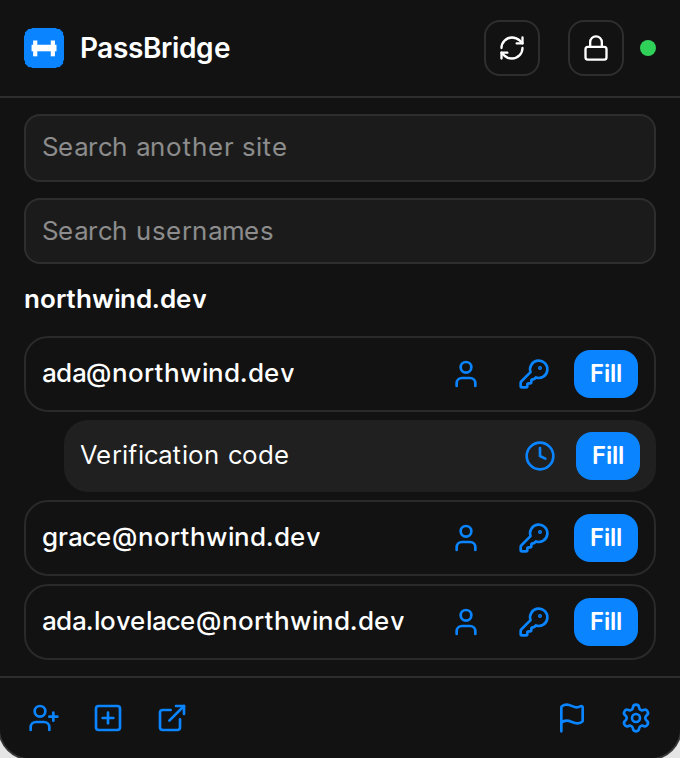
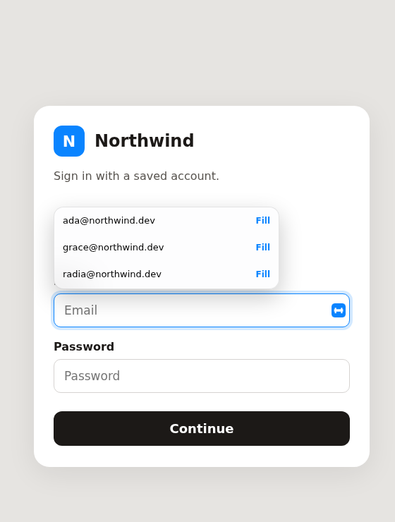
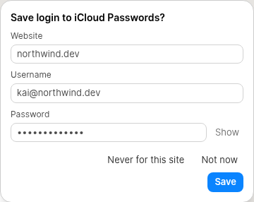

  

<h1 align="center">PassBridge</h1>

  在 Chrome 中用 iCloud 密码自动填充，体验与 Bitwarden 一致。
  支持 macOS 和 Windows。与 Apple 或 Bitwarden 无关。

  
  
  

🇺🇸 <a href="README.md">English</a>

  

PassBridge 最初是 [Open Passwords](https://github.com/ManiForoughi2/open-passwords) 的分支。它通过 Apple 原生消息协议（`com.apple.passwordmanager`）与 iCloud 通信，密码库始终保持在 iCloud 中。字段识别规则来自 [Bitwarden 浏览器扩展](https://github.com/bitwarden/clients)。如何同步最新的 Bitwarden、au2001 或 open-passwords 提交，请见 [UPSTREAMS.md](UPSTREAMS.md)。

从这里开始：macOS 和 Windows 用户请看 **[SETUP.md](SETUP.md)**。每个 [release](https://github.com/MehdiMamas/passbridge/releases) 都附带了构建好的扩展，解压后加载即可。

快速安装（详细步骤和检查方法见 [SETUP.md](SETUP.md)）：

1. 在 Chrome 中停用 Apple 自带的 iCloud 密码扩展。两个扩展使用同一个扩展程序 ID。
2. 从[最新版本](https://github.com/MehdiMamas/passbridge/releases/latest)下载 `passbridge.zip` 并解压。
3. 打开 `chrome://extensions`，启用开发者模式，点击「加载已解压的扩展程序」，选择解压后的文件夹。
4. 点击工具栏图标，输入 macOS 或 Windows 版 iCloud 显示的 6 位验证码。
5. 可选 helper：在 macOS 上解压 `passbridge-macos-helper.zip` 后运行 `sh native/install.sh`。在 Windows 上解压 `passbridge-windows-helper.zip`，然后双击 `install.cmd`。

  
  

  

  

## 功能特性

- 登录字段上的内联菜单，字段内显示图标，支持键盘导航，弹层不会被页面覆盖。
- Ctrl/Cmd+Shift+L 填充并切换匹配的登录。工具栏显示数量徽章。
- 右键菜单：填充、复制用户名、密码或验证码、生成密码。
- 保存/更新提示条，密码交给 Apple 自己的保存面板处理。没有面板确认就不会写入。
- 验证码来自 Passwords 应用，条目可以在 Passwords 应用中打开。

## 更新

PassBridge 每 30 分钟检查一次新版本，设置页的更新标签页有"立即检查"按钮。装好 helper 后，更新可以自动完成：

- **macOS：** `sh native/install.sh`，详见 [SETUP.md](SETUP.md)。
- **Windows：** 安装 [Python](https://www.python.org/downloads/)，解压 [最新 release](https://github.com/MehdiMamas/passbridge/releases/latest) 里的 `passbridge-windows-helper.zip`，双击 `install.cmd`，然后完全退出并重新打开 Chrome。

没有 helper 时，每次更新需要手动选择 PassBridge 文件夹，Windows 上 Chrome 还会对每个文件弹"保存 X.js？"。见 [SETUP.md](SETUP.md#automatic-updates-windows)。

## Apple 负责的部分

- 每次浏览器启动需要输入一次 6 位配对码，读取密码库时会请求 Touch ID 或 Windows Hello。
- 登录与网站的匹配由 helper 完成，没有逐条的"精确 URL"规则。
- Passkey 由 macOS 的 Chrome 通过 iCloud Keychain 自行处理；Windows 上通过 iPhone 扫码完成。除非在选项中开启可选的 Windows passkey 存储功能，PassBridge 不会存储或签名 passkey。见 [SETUP.md](SETUP.md#passkeys)。
- 不支持 Linux，也不上架 Chrome 应用商店。helper 只接受 Apple 的扩展 ID，因此需要以未打包方式加载。见 [SETUP.md](SETUP.md)。

## 致谢

- [ManiForoughi2/open-passwords](https://github.com/ManiForoughi2/open-passwords)（Apache-2.0），PassBridge 的起点。
- [au2001/icloud-passwords-firefox](https://github.com/au2001/icloud-passwords-firefox)（Apache-2.0），`src/apple/` 中的协议实现。
- [bitwarden/clients](https://github.com/bitwarden/clients)（GPL-3.0），自动填充字段列表。快照在 `vendor/bitwarden/` 下。不包含 `bitwarden_license/` 中的任何内容。
- [Open Runde](https://github.com/lauridskern/open-runde)（SIL OFL 1.1），界面字体。许可证在 `fonts/OFL.txt`。

贡献者：

- [Mahmuthan Elbir (@mahelbir)](https://github.com/mahelbir)："HTTP 页面填充并保存"设置（[#33](https://github.com/MehdiMamas/passbridge/pull/33)）和弹窗中验证码按登录分组（[#34](https://github.com/MehdiMamas/passbridge/pull/34)）。

见 [NOTICE](NOTICE)。许可证：GPL-3.0，见 [LICENSE](LICENSE)。

"Apple"、"iCloud"、"Passwords" 是 Apple Inc. 的商标。"Bitwarden" 是 Bitwarden Inc. 的商标。

> 🇨🇳 简体中文版：[README.zh-CN.md](README.zh-CN.md)
> 🇺🇸 English version: [README.md](README.md)
